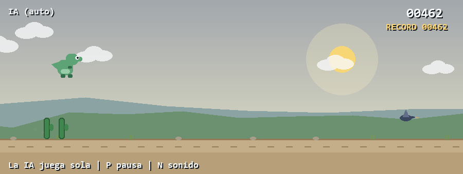

# Dino Runner with AI Agent

[](https://github.com/lushy6/dino-runner-ai/actions/workflows/ci.yml)



## Reproduce the agent benchmark

```sh
python -m pip install -r requirements.txt pytest
python -m pytest -q
python benchmark.py --runs 8 --seconds 600 --seed 0 --output benchmark-results.json
```

**Verified October 17, 2026:** 7 behavioral tests passed. Seeds 0–7 each survived 36,000 actual game updates (10 simulated minutes at 60 FPS) and reached top speed. All six hazard types spawned in each run; there were 675–719 spawned obstacles per run. Spawn counts are not cleared-obstacle counts. [Recorded results](docs/benchmark-results.json).

The benchmark uses the game's physics and collision loop, runs without rendering or wall-clock delays, exits nonzero on a collision, and never reads or changes the saved high score. These seeds do not guarantee survival on every possible course. CI repeats the tests and benchmark. The agent uses hand-written rules and trajectory simulation, not a trained ML model.

A Python/Pygame remake of the Chrome dinosaur game, with an AI mode that plays the game by itself.

Built as the final project for Data Structures & Algorithms II (IDS344L) at Instituto Tecnológico de Santo Domingo (INTEC).

**Authors:** Matias Birbuet · José Emilio García

## Features

- **Two modes:** play it yourself, or watch the AI play
- **Six hazard types** that unlock as the game speeds up: short cacti, tall cacti, birds at three heights, crabs that walk toward you, pits, and falling meteorites
- **AI agent** that decides each frame whether to jump, duck, or fast-fall
- **All sound generated in code:** sound effects and chiptune music are synthesized at runtime, with no audio files
- **Day/night sky,** parallax hills, particles, and screen shake
- **High score** saved between sessions

## How the AI works

The agent looks at the nearest obstacle and reacts using simple rules (a greedy strategy):

- **Ground obstacles** (cacti, crabs, pits): jump when the gap is small enough, based on the current speed. For crabs, the AI also adds the crab's own speed, since it is walking toward the dino.
- **Birds:** duck under mid-height birds and jump over low ones.
- **Meteorites:** the AI simulates the meteorite's fall frame by frame (up to 240 frames ahead) to predict whether it will cross the dino's position and at what height. Then it decides to jump, duck, or wait.
- **Fast-fall:** when the dino is in the air and the path ahead is clear, it drops faster to land sooner.

The logic lives in [`ai.py`](ai.py).

See the seeded benchmark and recorded results above for the current reproducible evaluation.

## Run it

Requires Python 3.10+.

```bash
pip install -r requirements.txt
python main.py
```

## Controls

| Key | Action |
| --- | --- |
| `1` | Start in player mode |
| `2` | Start in AI mode |
| `Space` / `↑` / `W` | Jump |
| `↓` / `S` | Duck (fast-fall in the air) |
| `P` | Pause |
| `R` | Restart after game over |
| `M` | Back to menu |
| `N` | Mute / unmute |
| `Esc` | Quit |

## Project structure

| File | What it does |
| --- | --- |
| `main.py` | Entry point and game loop |
| `juego.py` | Game state, obstacle spawning, collisions, scoring, screens |
| `ai.py` | AI agent and meteorite trajectory prediction |
| `dino.py` | Player character physics and animation |
| `obstaculo.py` | Obstacle types and their movement |
| `fondo.py` / `suelo.py` | Sky, hills, and ground drawing |
| `sonidos.py` | Procedural sound effects and music |
| `particula.py` | Dust particles |
| `record.py` | Saving and loading the high score |
| `constants.py` / `utils.py` | Settings, colors, and drawing helpers |

The code uses Spanish names (for example, `saltar` = jump, `agachar` = duck).
